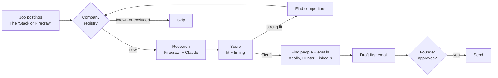

# FlowGen Deal Desk

An outbound agent for founder-led sales at FlowGen Labs.

Without a sales team, the founders spend hours finding companies that might need SAP automation, working out who to contact, and writing first emails. Deal Desk does that work every day and puts it in one shared workspace: it finds companies showing buying signals, checks them against FlowGen's ideal customer profile, finds the right people, and drafts a first email for each one. A founder reviews it and approves what goes out.

## What it does

| Step | What happens |
|---|---|
| **1. Source** | Finds companies hiring for SAP S/4HANA, ERP and finance-transformation roles, a strong sign a migration or finance overhaul is under way. Uses TheirStack job data, or job-board search through Firecrawl when no TheirStack key is set. |
| **2. Dedupe** | Checks every company against a shared **company registry**, so nothing is added or researched twice. Consultancies, integrators, staffing firms and SAP vendors are excluded and remembered. |
| **3. Research** | Reads each company's website, careers page and recent news, finds evidence of its SAP setup (ECC, S/4HANA, migration in flight) and collects dated buying signals with quotes and sources. |
| **4. Score** | Scores each account against the FlowGen ICP for **fit** and **timing**, and sorts it into Tier 1, 2 or 3 (see below). |
| **5. Expand** | For strong-fit accounts, finds direct competitors of similar size and adds them to the queue. |
| **6. Find people** | For Tier 1 accounts, fills the buying committee (champion, finance buyer, IT buyer) through Apollo. Every slot also has a ready-made LinkedIn and Sales Navigator search link for finding people by hand. |
| **7. Find emails** | Looks up work emails through Apollo or Hunter. Optional and capped per run, because it spends credits. |
| **8. Draft** | Writes a first email from one of four formats, picked by the account's strongest signal. |
| **9. Send** | Sends only the drafts a person has approved, through Resend or Gmail/SMTP, with an opt-out list, a required footer and a daily cap. |

Everything exports to one Excel workbook with sheets for accounts, contacts, signals, drafts and the company registry.



### How accounts are scored

Each account gets two scores out of 50.

- **Fit** is how close the company is to FlowGen's ideal customer: industry (oil and gas, life sciences, manufacturing, hi-tech, distribution) up to 15, SAP landscape (ECC scores highest) up to 15, revenue ($500M to $15B is the core band) up to 10, headquarters up to 5, ownership up to 5.
- **Timing** is how strong and recent the buying signals are. Each signal has a weight and a half-life, so it fades over time. Examples: an S/4HANA job posting (weight 25, half-life 60 days), a new CFO or CIO (20, 90 days), an acquisition (18, 120 days), evidence the company still runs ECC (15, 180 days).

| Tier | Rule | Meaning |
|---|---|---|
| **Tier 1** | Fit 35+ and timing 20+ | Right company, right moment. People are found and emails drafted. |
| **Tier 2** | Fit 35+ | Right company, no trigger yet. Watched for new signals. |
| **Tier 3** | Timing 20+ | A trigger, but a weaker fit. Worth a look. |

Accounts marked Open deal, Customer or Opted out are never contacted. The ICP, signal weights, personas and email formats all live in `api/_lib/icp.js`.

### The four email formats

1. **S/4 or SAP job posting:** opens with the role they're hiring for.
2. **New finance or IT leader:** written for someone in their first months in the job.
3. **Acquisition or merger:** about running two ERPs after a deal.
4. **ECC 2027 deadline:** for companies still on SAP ECC as mainstream support ends.

Each draft names the signal it's built on, and every draft can be edited before approval.

## Screens

- **Run:** start a full run, or a run without sourcing, and watch each step live. Shows a setup checklist, run history and today's usage against the daily limits.
- **Accounts:** every account with its tier, scores, signals and sources, editable fit fields, people, and drafts to edit, approve, copy or send.
- **People:** everyone found across accounts, with LinkedIn links.
- **Company registry:** every company ever seen, including excluded ones and the reason.
- **Import and export:** Excel export, paste a job list from any job board, add one company by hand, import CSV or JSON.
- **Settings:** API keys, test keys, team access, daily limits, sourcing rules, sender details and sending settings.

## Sharing with the team

Deal Desk is one shared workspace with two kinds of access.

- **Owner:** signs in with `ACCESS_CODE`. Adds the API keys, sets daily limits and controls team access.
- **Team:** signs in with a team code the owner sets in **Settings → Team access** (stored hashed). The team sees and works the same accounts, people, drafts and history, and every edit shows up for everyone.
- The team runs on the owner's API keys but **never sees them**, not even the last four characters. Only the owner can change keys, limits or the team code, or run Test keys. The team can still change sourcing rules, sender details and sending settings.
- **Daily limits** cap paid calls for everyone: Claude calls, Firecrawl calls, TheirStack jobs, Apollo calls and Hunter calls. When one runs out, runs stop with a clear message until midnight UTC.
- To revoke access, press **Turn off team access** or save a new team code. The old code stops working immediately.

## Starting data

The 17 accounts sourced before the live app, with their research, contacts and 4 Tier 1 accounts, are in `api/_lib/seed.js`. They load automatically the first time the app opens, deduplicated against anything already there. They load once, so deleting them later won't bring them back.

## Deploy (about 10 minutes)

1. Push this folder to a private GitHub repository.
2. In Vercel, choose **Add New → Project**, import the repository and deploy. No build settings are needed.
3. In the project, go to **Storage → Marketplace → Upstash (Redis)**, create a free database and connect it to the project.
4. In **Settings → Environment Variables**, add `ACCESS_CODE`, a long passphrase that becomes the owner code. Optionally add `CRON_SECRET` to turn on the weekday scheduled run.
5. **Redeploy** so the variables take effect.
6. Open the site and sign in with the access code. In **Settings**, paste the API keys and fill in the sender details.
7. Press **Test keys**. It confirms the database is connected and checks every key with a free call.
8. Set a team code under **Team access**, then go to **Run** and press **Run full pipeline**.

## API keys

| Service | Used for | Required |
|---|---|---|
| Anthropic | Reading job feeds, research, competitors, drafts | Yes |
| Firecrawl | Websites, careers pages and news; job search when TheirStack isn't set | Yes |
| TheirStack | Job postings for sourcing (1 credit per job; capped per run) | Recommended |
| Apollo.io | People search and work emails (People Search needs a paid plan) | No |
| Hunter.io | Work emails when Apollo has none | No |
| Resend, or Gmail/SMTP | Sending approved emails | Only to send |
| ZoomInfo, Clay, RocketReach | Placeholders for later | No |

Keys pasted in Settings are encrypted (AES-256-GCM, with the key derived from `ACCESS_CODE`) and stored in Redis. They are never sent back to the browser. Keys set as Vercel environment variables take priority. If you change `ACCESS_CODE`, paste the keys again.

## Settings worth knowing

- **TheirStack sourcing:** job titles to match and skip, technologies mentioned, countries, company size, and how many jobs to pull per run. Each run only asks for jobs posted since the last run, so credits aren't spent twice.
- **Job-portal search** (used without TheirStack): roles and job boards to search, and how recent the postings must be.
- **New companies per run** caps how many companies are added each run (default 15).
- **Competitors per account** defaults to 3. Competitors don't spawn competitors of their own.
- **Find emails automatically** is off by default because it spends Apollo or Hunter credits.
- **Exclude list** keeps existing customers or partners out.

## Sending rules

- Only drafts marked **Approved** are sent, and a sent email is never resent.
- Nothing sends until the footer includes a mailing address and an opt-out line.
- Emails or domains on the opt-out list are blocked.
- A daily send cap (default 25) applies across all sends.
- For more than a few dozen emails a day, send from a separate domain with SPF, DKIM and DMARC set up.

## How runs work

Each stage does one unit of work per request (one search batch, one account, one email), so runs never hit serverless time limits. The Run page calls the stages in order and shows each step live. The optional scheduled run (`vercel.json`, weekdays at 13:00 UTC) runs the same stages for up to about 4.5 minutes and never sends email.

Firecrawl calls go out one at a time with a short gap. If a provider hits a rate limit, the app waits as long as the provider asks and retries, and the Run page pauses for 40 seconds and continues. Set `FIRECRAWL_GAP_MS` (default 1500) higher on a free Firecrawl plan.

## Troubleshooting

- **"isn't set up" after saving a key:** usually no database is connected. Without Redis, each Vercel function has its own temporary disk, so Settings and the pipeline never see the same key. Connect Upstash Redis and redeploy. Test keys shows which storage is in use. These variable names all work: `KV_REST_API_URL` and `KV_REST_API_TOKEN`, `UPSTASH_REDIS_REST_URL` and `UPSTASH_REDIS_REST_TOKEN`, either with a custom prefix, or an Upstash `REDIS_URL`.
- **"saved keys can't be read":** `ACCESS_CODE` changed after the keys were saved. Paste them again.
- **Quick workaround:** add `ANTHROPIC_API_KEY` and `FIRECRAWL_API_KEY` as Vercel environment variables and redeploy.
- **"Today's limit is used up":** a daily limit was reached. The owner can raise it in Settings, or it resets at midnight UTC.
- **TheirStack free plan:** results come back 25 at a time. The app pages through them up to the per-run limit.

## Hidden for now: pull from Tsenta with Claude in Chrome

A panel under Import and export opens Tsenta and copies an instruction for Claude in Chrome, which reads the recommendations and imports them. It's hidden; remove `hidden` from `id="tsentaPanel"` in `public/index.html` to turn it back on.

## Project layout

```
api/
  state.js        everything the screens show
  run.js          runs one pipeline stage
  accounts.js     add, edit, import, research, contacts, drafts
  send.js         sends approved drafts
  export.js       Excel export
  settings.js     keys, team code, settings
  test-keys.js    free checks for each key
  cron.js         scheduled weekday run
  _lib/
    pipeline.js   the stages: source, research, competitors, people, emails, drafts
    icp.js        ICP, signals, scoring, personas, email formats
    providers.js  every outside API (Claude, Firecrawl, TheirStack, Apollo, Hunter, Resend, SMTP)
    keys.js       encrypted keys, settings, daily limits
    store.js      Upstash Redis storage
    auth.js       owner and team access
    seed.js       the 17 starting accounts
public/index.html the whole interface
scripts/          local server, fake APIs and the end-to-end test
```

## Local development

```bash
npm install
ACCESS_CODE=dev node scripts/dev-server.js           # real APIs, data stored in /tmp
ACCESS_CODE=dev MOCK=1 node scripts/dev-server.js    # fake APIs, no keys needed
npm test                                             # end-to-end test with fake APIs (40 checks)
```
